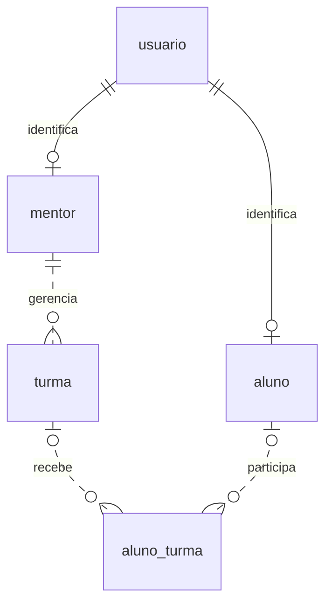
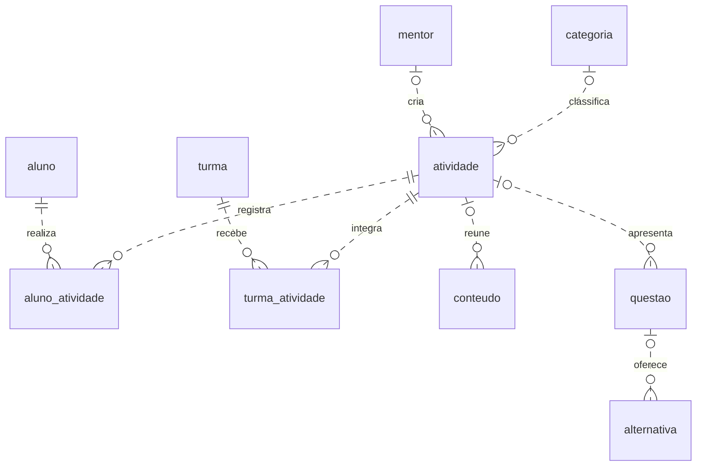

# GranaLab — Diagrama Entidade-Relacionamento (DER)

## 1. Objetivo

Documentar as 12 tabelas do banco `granalabteste`, seus atributos, relacionamentos e restrições conforme o script `scriptSQLgranalabteste.sql`. Atualizar este documento quando mudar uma tabela, coluna, chave, cardinalidade ou restrição.

## 2. Diagrama

O DER está dividido em duas vistas. Tabelas com o mesmo nome nas duas vistas representam a mesma entidade. Os símbolos junto a cada extremidade indicam quantos registros daquela tabela podem estar associados a um registro da outra. `||` indica exatamente um, `o|` ou `|o` indica zero ou um e `o{` indica zero ou muitos.

### Contas, turmas e matrículas

### Atividades, materiais e acompanhamento

## 3. Entidades

Cada tabela abaixo reproduz os nomes e tipos do SQL. A coluna **Aceita NULL** indica se o banco permite omitir o valor. PK identifica a chave primária e FK identifica uma chave estrangeira.

### `usuario`

Centraliza o nome, o e-mail, os dados de acesso, o avatar e o tipo de perfil de cada conta.

| Atributo      | Tipo SQL                  | Chave ou referência | Aceita NULL |
| ------------- | ------------------------- | ------------------- | ----------- |
| `id_user`     | `INT`                     | PK                  | Não         |
| `nome`        | `VARCHAR(100)`            | —                   | Não         |
| `email`       | `VARCHAR(100)`            | UNIQUE              | Não         |
| `senha_hash`  | `VARCHAR(255)`            | —                   | Sim         |
| `url_avatar`  | `VARCHAR(200)`            | —                   | Sim         |
| `tipo_perfil` | `ENUM('Mentor', 'Aluno')` | —                   | Não         |

### `aluno`

Complementa a conta do aluno com nível de perfil, data de nascimento e gênero.

| Atributo       | Tipo SQL              | Chave ou referência        | Aceita NULL |
| -------------- | --------------------- | -------------------------- | ----------- |
| `id_aluno`     | `INT`                 | PK, FK → `usuario.id_user` | Não         |
| `nivel_perfil` | `VARCHAR(100)`        | —                          | Não         |
| `data_nascimento`        | `DATE`                 | —                          | Não         |
| `genero`       | `ENUM('M', 'F', 'O')` | —                          | Não         |

### `mentor`

Complementa a conta do mentor com a escola em que atua.

| Atributo      | Tipo SQL       | Chave ou referência        | Aceita NULL |
| ------------- | -------------- | -------------------------- | ----------- |
| `id_mentor`   | `INT`          | PK, FK → `usuario.id_user` | Não         |
| `escola_atua` | `VARCHAR(100)` | —                          | Sim         |

### `turma`

Identifica a turma, seu mentor responsável e os indicadores de participação.

| Atributo          | Tipo SQL       | Chave ou referência     | Aceita NULL |
| ----------------- | -------------- | ----------------------- | ----------- |
| `id_turma`        | `INT`          | PK                      | Não         |
| `codigo`          | `VARCHAR(100)` | —                       | Não         |
| `titulo`          | `VARCHAR(100)` | —                       | Não         |
| `progresso_medio` | `INT`          | —                       | Sim         |
| `quant_alunos`    | `INT`          | —                       | Sim         |
| `id_mentor`       | `INT`          | FK → `mentor.id_mentor` | Não         |

### `aluno_turma`

Representa a matrícula de um aluno em uma turma e guarda seu percentual de desempenho.

| Atributo          | Tipo SQL | Chave ou referência   | Aceita NULL |
| ----------------- | -------- | --------------------- | ----------- |
| `id_aluno_turma`  | `INT`    | PK                    | Não         |
| `id_turma`        | `INT`    | FK → `turma.id_turma` | Sim         |
| `id_aluno`        | `INT`    | FK → `aluno.id_aluno` | Sim         |
| `porc_desempenho` | `INT`    | —                     | Sim         |

### `categoria`

Organiza as atividades por categoria.

| Atributo       | Tipo SQL        | Chave ou referência | Aceita NULL |
| -------------- | --------------- | ------------------- | ----------- |
| `id_categoria` | `INT`           | PK                  | Não         |
| `titulo`       | `VARCHAR(100)`  | —                   | Sim         |
| `descricao`    | `VARCHAR(1000)` | —                   | Sim         |

### `atividade`

Descreve uma atividade educativa e permite associá-la a um mentor criador e a uma categoria.

| Atributo       | Tipo SQL        | Chave ou referência           | Aceita NULL |
| -------------- | --------------- | ----------------------------- | ----------- |
| `id_atividade` | `INT`           | PK                            | Não         |
| `titulo`       | `VARCHAR(100)`  | —                             | Não         |
| `descricao`    | `VARCHAR(1000)` | —                             | Sim         |
| `data_criacao` | `DATE`          | —                             | Sim         |
| `id_criador`   | `INT`           | FK → `mentor.id_mentor`       | Sim         |
| `id_categoria` | `INT`           | FK → `categoria.id_categoria` | Sim         |

### `aluno_atividade`

Registra o início, a conclusão, o progresso e a pontuação de um aluno em uma atividade.

| Atributo         | Tipo SQL | Chave ou referência           | Aceita NULL |
| ---------------- | -------- | ----------------------------- | ----------- |
| `id_aluno_atv`   | `INT`    | PK                            | Não         |
| `id_aluno`       | `INT`    | FK → `aluno.id_aluno`         | Não         |
| `id_atv`         | `INT`    | FK → `atividade.id_atividade` | Não         |
| `data_inicio`    | `DATE`   | —                             | Sim         |
| `data_conclusao` | `DATE`   | —                             | Sim         |
| `porc_progresso` | `INT`    | —                             | Sim         |
| `pontuacao`      | `INT`    | —                             | Sim         |

### `turma_atividade`

Registra a atribuição de uma atividade à turma, com data, descrição do mentor, pontuação máxima e quantidade de conclusões.

| Atributo                  | Tipo SQL        | Chave ou referência           | Aceita NULL |
| ------------------------- | --------------- | ----------------------------- | ----------- |
| `id_turma_atv`            | `INT`           | PK                            | Não         |
| `id_turma`                | `INT`           | FK → `turma.id_turma`         | Não         |
| `id_atv`                  | `INT`           | FK → `atividade.id_atividade` | Não         |
| `data_atribuicao`         | `DATE`          | —                             | Sim         |
| `descricao_mentor`        | `VARCHAR(1000)` | —                             | Sim         |
| `pontuacao_max_atribuida` | `INT`           | —                             | Sim         |
| `quant_conclusao`         | `INT`           | —                             | Sim         |

### `conteudo`

Armazena material educativo em texto, imagem ou vídeo e permite vinculá-lo a uma atividade.

| Atributo            | Tipo SQL        | Chave ou referência           | Aceita NULL |
| ------------------- | --------------- | ----------------------------- | ----------- |
| `id_conteudo`       | `INT`           | PK                            | Não         |
| `titulo`            | `VARCHAR(100)`  | —                             | Sim         |
| `tipo`              | `VARCHAR(100)`  | —                             | Sim         |
| `texto_paragrafado` | `VARCHAR(3000)` | —                             | Sim         |
| `url_imagem`        | `VARCHAR(200)`  | —                             | Sim         |
| `url_video`         | `VARCHAR(200)`  | —                             | Sim         |
| `id_atv`            | `INT`           | FK → `atividade.id_atividade` | Sim         |

### `questao`

Armazena o enunciado e a pontuação de uma questão e permite vinculá-la a uma atividade.

| Atributo     | Tipo SQL       | Chave ou referência           | Aceita NULL |
| ------------ | -------------- | ----------------------------- | ----------- |
| `id_questao` | `INT`          | PK                            | Não         |
| `enunciado`  | `VARCHAR(100)` | —                             | Sim         |
| `pontuacao`  | `INT`          | —                             | Sim         |
| `id_atv`     | `INT`          | FK → `atividade.id_atividade` | Sim         |

### `alternativa`

Armazena o texto de uma opção de resposta e a indicação de que ela é correta.

| Atributo         | Tipo SQL       | Chave ou referência       | Aceita NULL |
| ---------------- | -------------- | ------------------------- | ----------- |
| `id_alternativa` | `INT`          | PK                        | Não         |
| `texto`          | `VARCHAR(300)` | —                         | Sim         |
| `correta`        | `BOOLEAN`      | —                         | Sim         |
| `id_questao`     | `INT`          | FK → `questao.id_questao` | Sim         |

## 4. Relacionamentos

| Vínculo                        | Como ler                                                                                                                                                                                                                                                                                             |
| ------------------------------ | ---------------------------------------------------------------------------------------------------------------------------------------------------------------------------------------------------------------------------------------------------------------------------------------------------- |
| Conta e perfis                 | Cada aluno e cada mentor referenciam exatamente uma conta. Por ser também chave primária, o identificador da conta ocorre no máximo uma vez em cada tabela de perfil. O SQL permite criar a conta antes do perfil e não verifica a correspondência entre o perfil criado e o valor de `tipo_perfil`. |
| Mentor e turmas                | Cada turma tem um mentor responsável. Um mentor pode gerenciar várias turmas ou ainda não ter criado nenhuma.                                                                                                                                                                                        |
| Alunos e turmas                | A tabela `aluno_turma` permite matricular um aluno em várias turmas e receber vários alunos na mesma turma. O SQL permite deixar qualquer uma das duas referências vazia.                                                                                                                            |
| Autoria e classificação        | Cada atividade pode referenciar até um mentor criador e até uma categoria. Um mentor pode criar várias atividades, e uma categoria pode reunir várias atividades.                                                                                                                                    |
| Alunos e atividades            | Cada linha de `aluno_atividade` exige um aluno e uma atividade. O progresso é individual e identificado pelo par aluno–atividade.                                                                                                                                                                    |
| Turmas e atividades            | Cada linha de `turma_atividade` exige uma turma e uma atividade. A mesma atividade pode ser atribuída a diversas turmas, cada uma com sua descrição e pontuação máxima.                                                                                                                              |
| Atividade, conteúdo e questões | Uma atividade pode reunir vários conteúdos e várias questões. Cada conteúdo ou questão pode referenciar até uma atividade.                                                                                                                                                                           |
| Questões e alternativas        | Uma questão pode ter várias alternativas. Cada alternativa pode referenciar até uma questão.                                                                                                                                                                                                         |

## 5. Restrições de integridade

- **Chaves primárias.** Cada tabela possui uma PK inteira de uma coluna. O script exige identificadores únicos e preenchidos. A geração com `AUTO_INCREMENT` não está declarada.
- **Chaves estrangeiras.** As 14 FKs estão identificadas na seção 3. Quando uma FK recebe um valor, o registro referenciado deve existir. Em `aluno` e `mentor`, o mesmo campo exerce as funções de PK e FK.
- **Unicidade.** Além das PKs, o banco exige e-mail único em `usuario`, par único `(id_aluno, id_atv)` em `aluno_atividade` e par único `(id_turma, id_atv)` em `turma_atividade`. A definição atual permite repetir o código de turma e o par aluno–turma em matrículas.
- **Obrigatoriedade.** As colunas marcadas com “Não” em **Aceita NULL** são obrigatórias. Por exemplo, toda turma exige código, título e mentor. Em `atividade`, o título é obrigatório e as referências ao criador e à categoria são opcionais.
- **Valores de domínio.** `usuario.tipo_perfil` admite `Mentor` e `Aluno`. O domínio de `aluno.genero` contém `M`, `F` e `O`. Os campos de percentual são inteiros sem restrição `CHECK` de intervalo no script.
